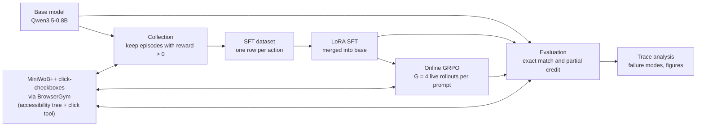
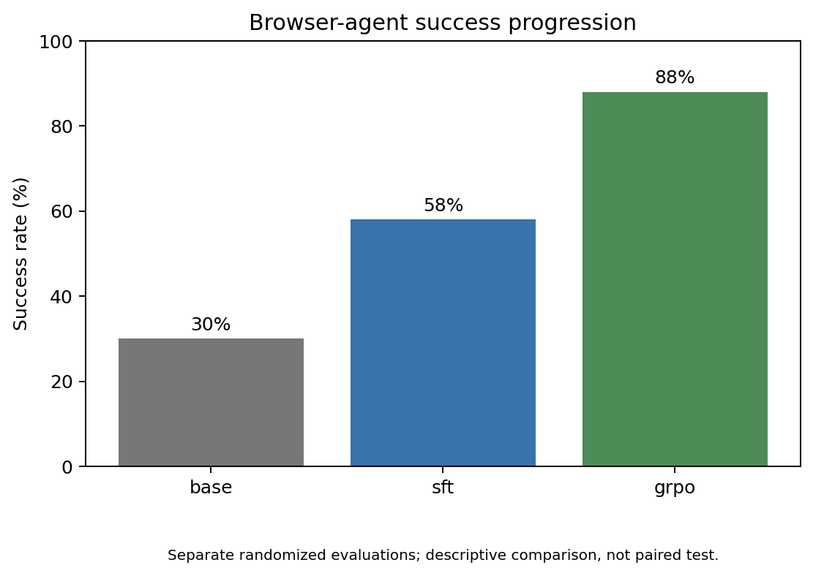

# openEnvRL: Small Models as Agents (SFT and GRPO on a Browser Task)

This repo takes `Qwen/Qwen3.5-0.8B` through SFT on 50 self-generated demonstrations, then 20 online GRPO
updates in a live browser, on the MiniWoB++ `click-checkboxes` task. On 50 fresh randomized
episodes per stage, exact-match success rises from **16% (base) to 42% (SFT) to 84% (GRPO)**.

Research article: [Small Models as Agents: SFT and GRPO on a Browser Task](https://palindromerice.github.io/writing/browser-agent-sft-grpo/)

## Why

Small models are often assumed unable to use tools reliably in interactive environments. This
project asks how much a 0.8B model gains from a cheap, standard pipeline, and what each stage
contributes. `click-checkboxes` is small but exercises the core agent loop: read the page, select
controls by identifier, track state (a second click unchecks a box), and decide when to submit.

## How it works



**Environment.** The accessibility tree is serialized to text with a numeric identifier per
control. For "Select MRW, 628 and click Submit":

```
[18] checkbox 'MRW'
[21] checkbox '628'
[24] checkbox 'w0e'
[27] button 'Submit'
```

The only action is `click(target)`, emitted as a Qwen-style tool call. An episode ends on Submit or
after ten actions. MiniWoB++ returns a raw reward in [-1, 1] with partial credit.

**Demonstrations.** The base model runs on fresh puzzles; the first 50 episodes with positive
reward are kept. No human or scripted demonstrations. Because partial credit passes the filter,
only 26 are exact, and 21 of those are zero-box puzzles.

**LoRA SFT.** One row per executed action (65 rows); rank 16, alpha 16, 60 updates, learning rate
2e-4, then merged into the base weights.

**Online GRPO.** From the SFT model, each of G = 4 completions per prompt runs in its own live
browser and gets a binary reward (1 if raw reward > 0). Group-normalized advantages; KL beta 0.04
to the SFT reference. 20 updates (about 80 rollouts), learning rate 1e-6.

**Evaluation.** Fresh randomized episodes per stage. Every tool call in a completion is executed
in order, one per browser turn. Primary metric is exact match (raw reward 1.0); default success
(raw reward > 0) is also reported. Collection and GRPO training used the lenient criterion.

## Results

| Model | Exact successes | Exact success | 95% Wilson interval | Default success (raw > 0) | Avg actions |
| --- | ---: | ---: | ---: | ---: | ---: |
| Base | 8 / 50 | 16% | 8% to 29% | 30% | 6.58 |
| + SFT | 21 / 50 | 42% | 29% to 56% | 64% | 3.76 |
| + GRPO (20 updates) | 42 / 50 | 84% | 71% to 92% | 94% | 2.88 |

Each stage uses an independently sampled set of 50 puzzles, so comparisons are descriptive, not paired.



*Exact-match success by training stage, 50 episodes each, scored by one evaluator.*

What the traces show:

- The base model's 16% comes almost entirely from zero-box puzzles (7 of 8). It exhausts the action
  budget in 30 of 50 episodes, mostly by clicking the same checkbox on all ten steps.
- SFT mainly teaches the output format and the select-then-submit structure. It reaches 33% to 45%
  exact success at every set size from one box upward, despite almost no exact multi-box demonstrations.
- GRPO removes the repeated-click loop entirely (zero budget-exhausted episodes) and solves all zero-
  and one-box puzzles in the sample and 17 of 19 two-box puzzles.
- Of the 8 remaining GRPO failures, 6 are premature submissions (5 stop exactly one box short) and 2
  select an unrequested box. Stopping short is consistent with the partial-credit-tolerant training
  reward, which pays the same for two of three boxes as for an exact answer.

All experiments ran on a single NVIDIA L4 GPU in Google Colab; the GRPO stage takes about ten minutes.

## Limitations

- **Single, simple task.** No claim about other browser tasks, real websites or long horizons.
- **Single training run.** Variance across GRPO seeds was not measured.
- **Small, unpaired samples.** Fifty episodes per stage, independently sampled; intervals are wide.
- **Lenient training signal.** Collection and GRPO used a partial-credit reward; headline results use exact match.

## License

Code and documentation are released under the Apache License 2.0. See `LICENSE` and `NOTICE`.

## Citation

```bibtex
@misc{chawla2026browseragentsftgrpo,
  author       = {Naman Chawla},
  title        = {Small Models as Agents: SFT and GRPO on a Browser Task},
  year         = {2026},
  howpublished = {\url{https://palindromerice.github.io/writing/browser-agent-sft-grpo/}}
}
```

Citation metadata is also available in `CITATION.cff`.

## Acknowledgements

Thanks to Riya Dhami for code contributions to this repository.
