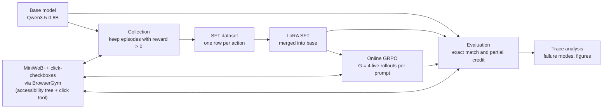

# openEnvRL: Small Models as Agents (SFT and GRPO on a Browser Task)

This repository is the code behind the paper
[Small Models as Agents: SFT and GRPO on a Browser Task](https://palindromerice.github.io/writing/browser-agent-sft-grpo/).
It takes `Qwen/Qwen3.5-0.8B` through a standard two-stage post-training recipe on the MiniWoB++
`click-checkboxes` task: supervised fine-tuning (SFT) on 50 self-generated demonstrations, then
20 online GRPO updates in a live browser with a binary environment reward. On 50 fresh randomized
episodes per stage, exact-match success rises from **16% (base) to 42% (SFT) to 84% (GRPO)**. The
whole pipeline runs on a single NVIDIA L4 GPU, and the GRPO stage takes about ten minutes.

## Why

Web agents are usually built on large models, and small models are often assumed to be unable to
use tools reliably in an interactive environment. This project asks a narrow question: on a simple
browser task, how much can a 0.8B model gain from a cheap, standard pipeline, and what does each
stage contribute? `click-checkboxes` is small, but it exercises the core loop of a browser agent:
read a page representation, select controls by identifier, act, track state across steps (clicking
a checkbox twice unchecks it), and decide when to submit. Its size also lets a live browser sit
inside the RL loop on one GPU.

## System design

The pipeline has four stages (collect, fine-tune, reinforce, evaluate) plus an offline trace
analysis. Every stage reads and writes plain JSONL/JSON artifacts, so each one can be rerun or
inspected in isolation.



**Environment wrapper.** `src/env/native_browsergym_task.py` wraps BrowserGym's MiniWoB++ task and
serializes the accessibility tree to text, with a numeric identifier per control. For the
instruction "Select MRW, 628 and click Submit", the observation looks like:

```
[18] checkbox 'MRW'
[21] checkbox '628'
[24] checkbox 'w0e'
[27] button 'Submit'
```

The agent acts through a single tool, `click(target)`, emitted as a Qwen-style tool call. An
episode ends on Submit or after a budget of ten actions. MiniWoB++ returns a raw reward in
[-1, 1] with partial credit; the wrapper marks an episode successful when the raw reward is
positive. `src/env/openenv_task.py` is an alternative backend over the OpenEnv BrowserGym client,
kept for comparison; the native backend is the default and the one used for all reported results.

**Demonstration collection.** `src/pipeline/collect.py` runs the base model on fresh puzzles and
keeps the first 50 episodes the environment scores as successful. No human or scripted
demonstrations are used. Because the filter accepts partial credit, only 26 of the 50 are exact,
and 21 of those are zero-box puzzles. Episodes are checkpointed to JSONL after every success and
validated against the trajectory schema in `src/data/trajectory_schema.py`.

**LoRA SFT.** `src/data/build_sft_dataset.py` splits each episode into one row per executed action
(65 rows). `src/train/sft.py` trains a LoRA adapter (rank 16, alpha 16, 60 updates, learning rate
2e-4, sequence length 1024) and merges it into the base weights.

**Online GRPO.** `src/train/grpo.py` starts from the merged SFT model and uses TRL's GRPO trainer
with an environment factory: each of the G = 4 completions for a prompt is executed in its own live
browser instance and receives a binary reward (1 if raw reward > 0). Advantages are rewards
normalized within the group, so a group with uniform rewards contributes no gradient. A KL penalty
(beta 0.04) keeps the policy near the SFT reference. The reported run is 20 updates (about 80
rollouts), learning rate 1e-6, 8-bit AdamW, 1024/128 prompt/completion tokens.

**Evaluation.** `src/eval/run_eval.py` and `src/eval/metrics.py` score a policy on fresh randomized
episodes. All three reported stages are evaluated through `src/agents/grpo_tool_policy.py`, which
parses every tool call in a completion in order and executes one per browser turn, so a model may
emit a whole multi-click plan in one generation. Two criteria are reported: exact match (raw reward
equal to 1.0, the primary metric) and default success (raw reward > 0). Collection and GRPO
training both used the lenient criterion.

**Trace analysis.** `src/analysis/` loads per-episode records, validates them, classifies failures
with deterministic rules (budget exhausted, premature Submit, unrequested box selected), and renders
figures and a report. `scripts/build_article_analysis.py` produces the tracked figures in
`figures/article_analysis/`.

## Results

| Model | Exact successes | Exact success | 95% Wilson interval | Default success (raw > 0) | Avg actions |
| --- | ---: | ---: | ---: | ---: | ---: |
| Base | 8 / 50 | 16% | 8% to 29% | 30% | 6.58 |
| + SFT | 21 / 50 | 42% | 29% to 56% | 64% | 3.76 |
| + GRPO (20 updates) | 42 / 50 | 84% | 71% to 92% | 94% | 2.88 |

Each stage is evaluated on an independently sampled set of 50 puzzles, so comparisons across stages
are descriptive rather than paired.


*Success by training stage under the environment's default (partial-credit) criterion. Exact-match
rates for the same episodes are in the table above.*

What the traces show:

- The base model's 16% comes almost entirely from zero-box puzzles (7 of 8). It exhausts the action
  budget in 30 of 50 episodes, mostly by clicking the same checkbox on all ten steps.
- SFT mainly teaches the output format and the select-then-submit structure. It reaches 33% to 45%
  exact success at every set size from one box upward, despite having almost no exact multi-box
  demonstrations.
- GRPO removes the repeated-click loop entirely (zero budget-exhausted episodes) and solves all zero-
  and one-box puzzles in the sample and 17 of 19 two-box puzzles.
- Of the 8 remaining GRPO failures, 6 are premature submissions (5 stop exactly one box short) and 2
  select an unrequested box. Stopping short is consistent with the partial-credit-tolerant training
  reward, which pays the same for two of three boxes as for an exact answer.

## Repository map

| Path | Role |
| --- | --- |
| `src/env/` | Environment backends (native BrowserGym/MiniWoB++, OpenEnv), accessibility-tree serialization, action parsing and formatting, environment probe helpers |
| `src/agents/` | Prompt construction, policies (base/SFT text policy, GRPO tool-call policy, scripted manual policy for smoke tests), single-episode rollout |
| `src/data/` | Trajectory step schema, atomic JSONL storage, SFT dataset builder |
| `src/pipeline/` | Collection loop with validation, and the named-phase registry that wires every stage together |
| `src/train/` | SFT (LoRA, merge, export validation) and GRPO (environment factory, reward, trainer) |
| `src/eval/` | Policy evaluation loop and metric aggregation |
| `src/analysis/` | Artifact loading and validation, failure classification, plots, Markdown reports |
| `src/cli/`, `src/config.py`, `src/artifacts.py` | Phase CLI, YAML config loading, artifact-root layout and run manifests |
| `scripts/` | Phase runner, full SFT and resumable GRPO drivers, Colab entry points, figure builder |
| `configs/default.yaml` | Single source of run settings |
| `notebooks/orchestrator.ipynb` | Optional notebook for orchestration, inspection and plotting |
| `figures/article_analysis/` | Tracked figures used in the paper, with a README describing each |
| `tests/` | Unit tests mirroring the `src/` layout, plus fixtures |

## Orientation for agents

**Pipeline entry points.** The pipeline is a fixed list of named phases defined in
`src/pipeline/run_all.py`: `native_probe`, `openenv_probe`, `manual_smoke`, `baseline_eval`,
`collect_successes`, `build_sft_dataset`, `sft_train`, `sft_eval`, `sft_manifest`, `grpo_train`,
`grpo_eval`, `analysis`. `src/cli/run_phase.py` (exposed as `scripts/run_phase.py`) runs one phase
at a time. Longer runs have dedicated drivers: `scripts/run_sft_full.py` for collection through SFT,
and `scripts/run_grpo_full.py` for checkpointed, resumable GRPO with evaluation at each checkpoint
boundary. The `manual_smoke` phase uses a scripted policy and is the quickest check that the real
task is wired correctly before any model is involved.

**Config system.** All settings live in `configs/default.yaml` (model ID, task ID, backend, episode
budget, evaluation sizes, batch settings, output directories) and are loaded as a plain dict.
Profiles (`smoke`, `sft_smoke`, `full`) override a few counts in code so a pipeline can be exercised
cheaply before a full run. Training hyperparameters for each stage are assembled in
`build_sft_job_config` and `build_grpo_job_config`.

**Where artifacts go.** By default, phases write to `data/`, `results/` and `models/` relative to
the repo; none of these are tracked. When an artifact root is given, `src/artifacts.py` creates a
per-run layout (`data/`, `results/`, `models/sft_adapter`, `models/sft_model`, `models/grpo_model`)
under that root and writes run manifests with file hashes and sizes. Key artifacts:
`successful_trajectories.jsonl`, `sft_dataset.jsonl`, `sft_metrics.json`,
`grpo_eval_step_<N>.json` with a matching per-episode JSONL, and `report.md`.

**Colab versus local execution.** Training and live-browser phases were run on a Google Colab GPU
runtime. The `scripts/colab_*` and `scripts/_colab_*` entry points and the notebook assume that
runtime, with Google Drive mounted at `/content/drive/MyDrive` and the project and artifact roots
under it; artifact roots outside that prefix are rejected. MiniWoB++ assets are placed on local disk
rather than Drive for speed. The `src/` code itself is not Colab-specific: config paths, the
BrowserGym environment and the trainers run anywhere with a suitable GPU, Python environment and a
Playwright Chromium install.

**Tests.** `tests/` mirrors `src/` (`agents/`, `env/`, `data/`, `pipeline/`, `train/`, `eval/`,
`analysis/`, `cli/`), with top-level tests for config, artifacts and the full-run drivers. They use
fakes, monkeypatched environments and policies, and recorded fixtures in `tests/fixtures/analysis/`
(metrics, manifests and per-episode JSONL) rather than a live browser or GPU, so they run quickly on
any machine. `tests/conftest.py` only puts the repo root on the import path.

## Limitations

- **Single, simple task.** Results concern randomized `click-checkboxes` episodes only; no claim is
  made about other browser tasks, real websites or long-horizon workflows.
- **Single training run.** Variance across GRPO seeds was not measured.
- **Small samples.** Fifty episodes per stage give wide intervals; per-size buckets are smaller still.
- **Unpaired evaluation.** Each stage used an independently sampled set of puzzles, not a fixed
  test set.
- **Lenient training signal.** Collection and GRPO used a partial-credit-tolerant reward, while
  headline results are reported under exact match.

## License

Code and documentation are released under the Apache License 2.0. See `LICENSE` and `NOTICE`.

## Citation

If you use this code or its results, please cite:

```bibtex
@misc{chawla2026browseragentsftgrpo,
  author       = {Naman Chawla},
  title        = {Small Models as Agents: SFT and GRPO on a Browser Task},
  year         = {2026},
  howpublished = {\url{https://palindromerice.github.io/writing/browser-agent-sft-grpo/}}
}
```

Citation metadata is also available in `CITATION.cff`.

## Acknowledgements

Thanks to Riya Dhami for code contributions to this repository.
