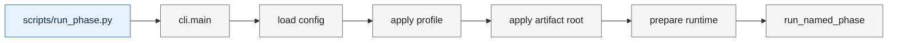
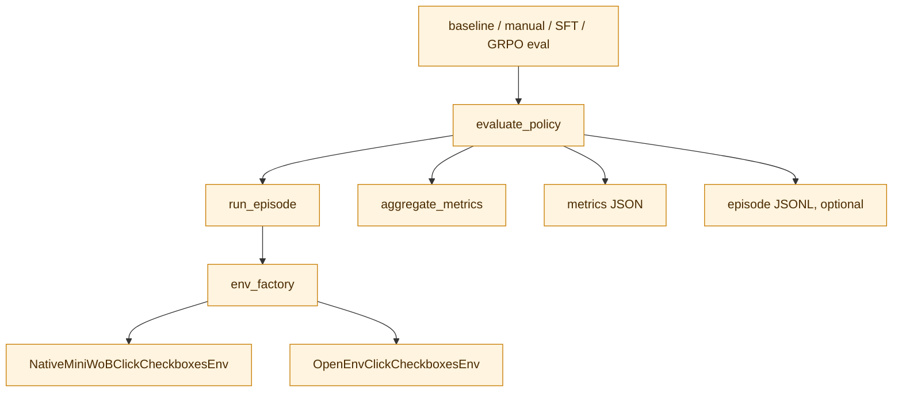
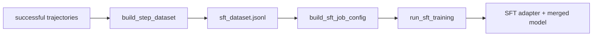
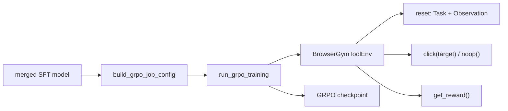
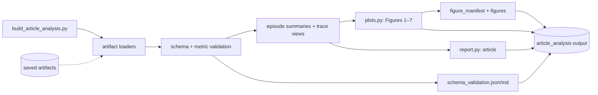

# Repo Flow

Readable map of current runtime. Planned article analysis shown separately. Arrows mean “calls” or “writes”. Dashed arrows mean “reads”.

## 1. Entry path

`run_named_phase` selects one phase from `list_pipeline_phases()`.

## 2. Pipeline stages

```mermaid
flowchart LR
    P1["1. probes"] --> P2["2. baseline eval"]
    P2 --> P3["3. collect successes"]
    P3 --> P4["4. build SFT dataset"]
    P4 --> P5["5. SFT train"]
    P5 --> P6["6. SFT eval + manifest"]
    P6 --> P7["7. GRPO train"]
    P7 --> P8["8. GRPO eval"]
    P8 --> P9["9. analysis"]

    classDef stage fill:#eef7ee,stroke:#4d8b57,color:#173b1a
    class P1,P2,P3,P4,P5,P6,P7,P8,P9 stage
```

Code owner:

| Stage | Main function | Main output |
| --- | --- | --- |
| Probes | `run_native_probe_phase`, `run_openenv_probe_phase` | readiness result |
| Baseline | `run_baseline_eval_phase` | baseline metrics JSON |
| Collection | `run_collection_phase` → `run_collection_loop` | successful trajectories JSONL |
| Dataset | `run_sft_dataset_phase` → `write_step_dataset` | SFT dataset JSONL |
| SFT train | `run_sft_phase` → `run_sft_training` | adapter + merged model |
| SFT eval | `run_sft_eval_phase` → `evaluate_policy` | SFT metrics JSON |
| GRPO train | `run_grpo_phase` → `run_grpo_training` | GRPO checkpoint |
| GRPO eval | `run_grpo_eval_phase` → `evaluate_policy` | metrics JSON + episode JSONL |
| Analysis | current `run_analysis_phase` → `write_report` | report Markdown |

## 3. Shared evaluation path

## 4. Training paths

### SFT

### GRPO

## 5. Article-analysis path

Implemented. Reads saved artifacts. Does not train, evaluate, open BrowserGym, use Colab, or load models.

Inputs:

- `artifacts/2026-07-12-sft-full/`
- `artifacts/2026-07-26-grpo-gate-r5/`
- `docs/notes/2026-07-27-click-checkboxes-sft-grpo-technical-report.md`

## Key contracts

| Function | Input | Output |
| --- | --- | --- |
| `run_episode` | environment + policy | one episode record |
| `evaluate_policy` | environment factory + policy | aggregate metrics; optional episode JSONL |
| `run_collection_loop` | environment factory + policy | successful trajectory JSONL |
| `build_step_dataset` | successful trajectories | step-level SFT rows |
| `run_sft_training` | SFT rows + config | adapter + merged model |
| `run_grpo_training` | SFT model + config | GRPO checkpoint |
| `GRPOToolPolicy` | checkpoint + observation | parsed tool action |
| `artifact_analysis` | JSON/JSONL/manifests | validated records + provenance + trace views |
| `plots.py` | validated records | seven figures + caption metadata |
| `report.py` | metrics/traces/figures | article + validation report |

## Evidence boundary

Analysis reads saved artifacts only. `artifact_analysis.py` validates metrics, manifests, SFT demonstrations, and final GRPO episode records; it emits episode summaries and trace views. `plots.py` renders seven deterministic figures with caption/source metadata. `report.py` writes article + schema reports. `build_article_analysis.py` orchestrates this path. Verified output: `results/article_analysis/`. Tool-use queue shown in figures is derived from raw completions + executed steps; queue is not standalone persisted field. Base/SFT model-eval traces unavailable; no invented cross-stage action distributions.
